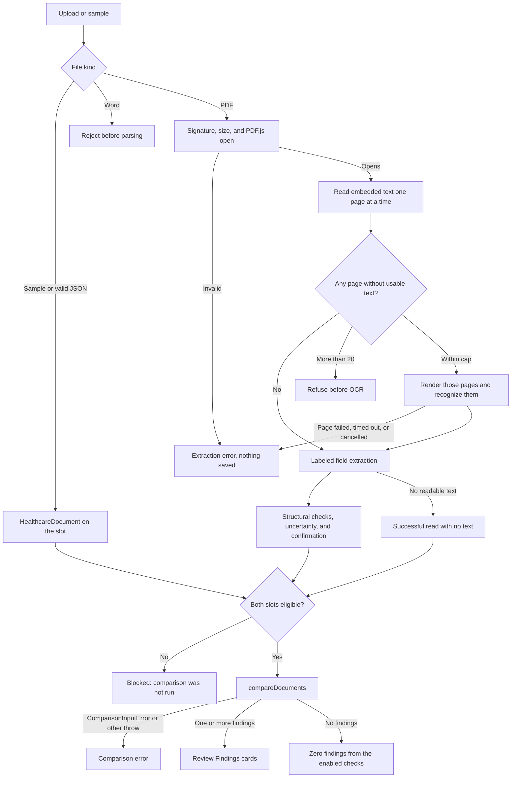
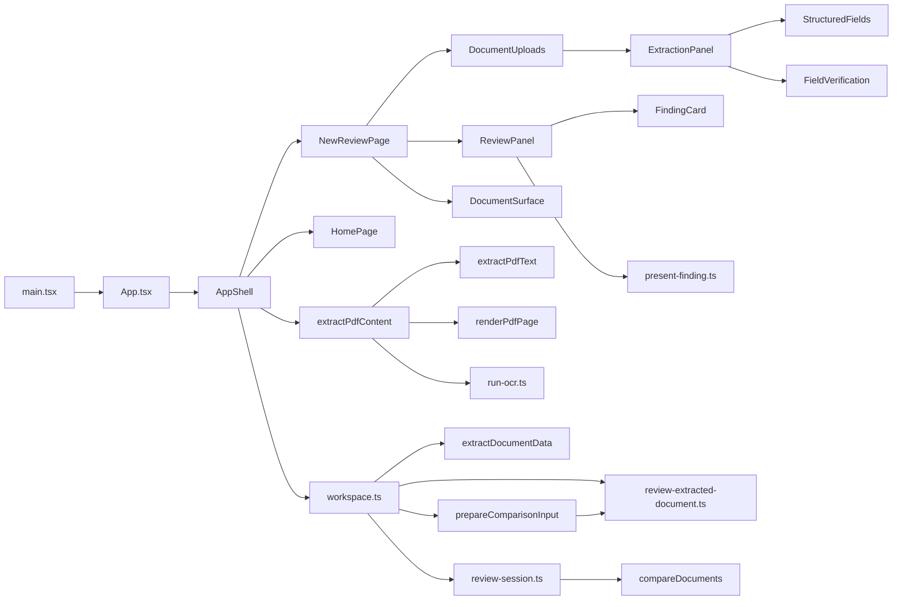

# CareDocs AI — Architecture

> **Status:** Living architecture document  
> **Last reviewed:** 2026-10-31  
> **Scope:** The Vite application in this directory. The git repository root is the parent directory. There is no `README.md` at the git root. Run npm from this directory.

This document describes the implementation that is in the source tree. It is an engineering reference, not a product claim. CareDocs AI is a portfolio prototype. It is not a clinically validated product.

## 1. Purpose and product boundaries

CareDocs AI helps a person compare a discharge letter with a medication plan. It reads a structured JSON template, or a PDF whose labeled text can be turned into fields, and it shows potential discrepancies and documentation gaps for that person to review.

The supported document types are `discharge-letter` and `medication-plan`. A slot accepts one of those JSON templates, a PDF, or the built-in synthetic sample for that slot. Word files are rejected before parsing.

The application is a human-reviewed comparison assistant. A finding records that two values differ, or that an enabled check did not find a detail in the compared text. It does not decide which value is correct, recommend a medication change, or confirm a clinical error. Extraction success, structural validation, OCR confidence, and a reviewer’s confirmation are separate facts. None of them is clinical correctness.

The application does not:

- diagnose, prescribe, or choose an authoritative value;
- use a language model;
- send page images to an OCR service;
- authenticate a reviewer or keep an audit trail;
- persist a review across refresh;
- provide a backend, database, or authorization layer.

Every patient and clinical string in the repository is fictional.

## 2. Technology stack

Versions below are the copies installed in `package-lock.json`. `package.json` declares compatible ranges.

| Technology | Installed | Responsibility |
| --- | --- | --- |
| React / React DOM | 19.3.1 | UI. `App` renders `AppShell`. State is one `useState` in `AppShell`. |
| TypeScript | 6.0.3 | Static types. `npm run build` runs `tsc -b` before Vite. |
| Vite | 8.3.5 | Dev server and production build. `@vitejs/plugin-react` 6.x compiles JSX. |
| pdfjs-dist | 6.4.299 | Parse PDFs and read embedded text. The legacy build is used. The browser worker is `pdf.worker.min.mjs`. |
| tesseract.js | 7.0.0 | Recognize pages that have no usable embedded text. Language code `deu`. |
| lucide-react | 1.61.0 | Status icons on finding cards. |
| Vitest | 5.0.5 | `npm test` is `vitest run`. |
| happy-dom | 21.0.4 | Test DOM. Configured in `vite.config.ts`. |
| React Testing Library | 16.3.3 | Component and workspace tests. user-event 14.6.8 drives clicks and uploads. |
| Oxlint | 1.89.0 | `npm run lint`, using `.oxlintrc.json`. |

Not installed and not used: a router, a state library, a validation library, a language-model client, and a backend framework.

## 3. High-level architecture

The UI renders state and emits actions. Domain rules stay in `src/features/document-review/` and do not import React. That split keeps comparison and extraction testable without the page, and it stops a component from inventing a finding.

```text
src/
├── main.tsx                         StrictMode and the React root
├── app/
│   ├── App.tsx                      renders AppShell only
│   └── workspace.test.tsx           upload, comparison, and findings integration
├── components/
│   ├── layout/
│   │   ├── AppShell.tsx             React state, upload, abort, compare
│   │   ├── workspace.ts             pure workspace transitions
│   │   ├── AppHeader.tsx
│   │   ├── SideNav.tsx              Home and New Review
│   │   ├── DocumentUploads.tsx
│   │   ├── ExtractionPanel.tsx      page text and extraction status
│   │   ├── StructuredFields.tsx
│   │   ├── FieldVerification.tsx    edit and confirm one field
│   │   ├── ReviewPanel.tsx          Review Findings
│   │   ├── FindingCard.tsx
│   │   ├── DocumentSurface.tsx      source documents for a finished comparison
│   │   ├── section-target.ts        DOM ids for evidence focus
│   │   └── layout.css
│   └── pages/
│       ├── HomePage.tsx
│       ├── NewReviewPage.tsx
│       └── pages.css
├── features/document-review/
│   ├── extraction/                  PDF.js, OCR, labeled fields
│   ├── verification/                structural checks and confirmation
│   ├── comparison/                  eligibility adapter and comparison rules
│   ├── findings/present-finding.ts  view model for one finding
│   ├── review-session.ts            calls the engine and stores finding status
│   ├── template-validation.ts       JSON template checks
│   └── privacy.test.ts              static scan of application source
├── data/                            synthetic fixtures and the checklist
├── types/
│   ├── document.ts
│   └── review.ts
└── styles/                          design tokens and global CSS
```

| Area | Responsibility |
| --- | --- |
| Application shell | `AppShell` owns workspace state, file reads, abort controllers, and generation counters. It does not compare documents itself. |
| Workspace state | `workspace.ts` is a pure transition module: accept, extract, edit, confirm, compare, block, fail, and clear. |
| Document upload | `DocumentUploads` shows the two slots. `ExtractionPanel`, `StructuredFields`, and `FieldVerification` show a PDF read and its review. |
| Extraction | `extractPdfContent` reads a PDF. `extractDocumentData` reads labeled fields from that text. |
| Verification | `createDocumentVerification` copies extraction into reviewed fields. Confirmation is per field and stays in memory. |
| Comparison | `prepareComparisonInput` decides whether a pair may be compared. `compareDocuments` is the only comparison engine. |
| Findings presentation | `present-finding.ts` joins engine evidence to reviewed PDF fields. `ReviewPanel` and `FindingCard` render that view. |
| Types and fixtures | `src/types/` is the domain model. `src/data/` holds synthetic documents, the checklist, and an acceptance fixture that is not engine output. |

There is no API client, database, or service layer.

## 4. End-to-end data flow

JSON and PDF enter the same two slots, then meet at comparison. A sample button stores the fixture directly and skips file parsing.

| Stage | Input | Output | Main files | Sync | Failure |
| --- | --- | --- | --- | --- | --- |
| Upload | `File`, or the sample button | Slot filename, or a rejection message | `AppShell.tsx` | The click is sync. PDF and JSON reads are async. | Word files are rejected before parsing. A failed upload does not load a sample. |
| File validation | PDF or JSON bytes | A parsed PDF, or a `HealthcareDocument` | `extract-pdf-text.ts`, `template-validation.ts` | PDF open is async. JSON parse is sync after `file.text()`. | Extension and MIME type are not trusted for a PDF. JSON over 1 MiB is rejected before `file.text()` is parsed. |
| PDF parsing | Bytes that contain `%PDF-` | `PDFDocumentProxy` | `extract-pdf-text.ts` | Async | Empty, oversized, encrypted, and unreadable files throw `PdfTextExtractionError`. The message does not pass through the PDF.js error text. |
| Embedded text | One page at a time | Page string, or empty | `extractPdfText` | Async, sequential pages | A page is released after its text is read. The document is closed in `finally`. |
| OCR fallback | Pages whose text trims to empty | Page string, method `ocr`, confidence or null | `extract-pdf-content.ts`, `render-pdf-page.ts`, `run-ocr.ts` | Async. Pages in one document are sequential. | More than 20 scanned pages is refused before OCR. A failed page fails the whole document and names the page number only. |
| Structured extraction | `PdfTextExtractionResult` | `StructuredDocumentExtraction` | `extract-document-data.ts` | Sync | Missing and ambiguous fields stay missing or ambiguous. Nothing is guessed. |
| Evidence association | Label match in page text | Source span, page number, text source | `extract-document-data.ts` | Sync | A field without source text stays without it. |
| Structural validation | Reviewed value and evidence | `structural` and `uncertainty` lists | `review-extracted-document.ts` | Sync | These lists are not combined into one success flag. |
| Human verification | Reviewer edit or confirm | `reviewedValue`, `verification` | `FieldVerification.tsx`, `review-extracted-document.ts` | Sync | Confirming one field does not confirm the others. An edit returns that field to unverified. |
| Comparison eligibility | Both slots | `{ letter, plan }` or reason codes | `prepare-comparison-input.ts` | Sync | Ineligible pairs do not call `compareDocuments`. |
| Comparison engine | Two `HealthcareDocument`s and the checklist | `ReviewFinding[]` | `compare-documents.ts` | Sync | `ComparisonInputError` names the missing field, not the clinical value. |
| Findings generation | Engine findings | `ReviewState` with status `not-started` and findings `open` | `review-session.ts` | Sync | The UI phase is not stored here. |
| Findings presentation | `ReviewState`, compared documents, verification sources | Cards, counts, filters | `present-finding.ts`, `ReviewPanel.tsx`, `FindingCard.tsx` | Sync render. Scroll into view after the phase changes. | Idle, blocked, error, zero findings, and findings stay distinct. |
| Reviewer interaction | Status select, evidence button, field edit | In-memory status or a cleared review | `AppShell.tsx`, `workspace.ts` | Sync | Opening evidence does not change finding status. Replacing a document clears the review. |

`AppShell.handleCompare` calls `requestCompare`, then `completeCompare` on a zero-delay timer so the `comparing` phase can paint. `completeCompare` runs only while `phase` is `comparing`, calls `prepareComparisonInput` again, and then `createReviewSession`. A generation counter drops that completion if a newer compare, a removal, or unmount cancelled it.

A PDF with no readable text is status `no-text`. That is a completed read, not an extraction error and not a comparison result. `canCompare` becomes true, and the later comparison is blocked.

## 5. PDF extraction and OCR

`extractPdfText` and `openValidatedPdf` use `pdfjs-dist/legacy/build/pdf.mjs`. In the browser, `GlobalWorkerOptions.workerSrc` points at `pdf.worker.min.mjs` resolved from `import.meta.url`. Vitest runs in Node, which already loads the worker beside `pdf.mjs`, so that path is not overwritten there.

Validation order for a PDF:

1. The name or MIME type must look like a PDF, or the file is rejected as not a PDF.
2. Empty files and missing names are rejected.
3. Files larger than `maxPdfFileBytes` (20 MiB) are rejected.
4. The first 1024 bytes must contain `%PDF-`.
5. PDF.js must open the file. `PasswordException` and `InvalidPDFException` become controlled messages. Other parser errors become “The PDF text could not be extracted.”
6. `numPages` must be between 1 and `maxPdfPages` (50).

Embedded text is read one page at a time with `getTextContent`. Each page is released with `page.cleanup()` afterward. Cleanup errors are swallowed so they do not hide the extraction result.

`extractPdfContent` calls that read first. A page whose text trims to empty is a scanned page. Pages that already have text are not rendered. If there are no scanned pages, the function returns without opening the PDF again. If there are scanned pages, it opens the PDF a second time, creates one Tesseract worker, and recognizes those pages in order. The second open is intentional: there is no cache that could serve a replaced file.

Rendering uses scale `ocrPageScale` (2). The canvas is passed to the worker and then released by setting its width and height to 0. The page is released after render.

`createOcrSession` calls `Tesseract.createWorker('deu')`. German is the language of the sample documents. On first use, Tesseract.js may download German language data and its WebAssembly runtime. That download is not the page image. The page stays in the browser. Confidence is the finite number Tesseract returns, or `null`. It is recognizer confidence, not a clinical score, and the UI shows it only when the library returned it.

Limits and stops:

| Limit | Value | Behavior |
| --- | --- | --- |
| File size | 20 MiB | Rejected before parse. |
| Page count | 50 | Rejected. The file is not partially read. |
| Scanned pages | 20 (`maxOcrPages`) | Refused before OCR starts. The message says the file was not partially read. |
| Duration | 3 minutes (`maxPdfProcessingMs`) | The in-flight read is aborted. The document is not saved. |

A recognition or render failure throws `PdfTextExtractionError` with the page number and does not keep earlier OCR pages. Caller cancellation and the timeout share an internal `AbortController`. The worker is terminated and the PDF document is closed in `finally`, including on failure. An abort before the PDF is opened does not call dispose.

Two slots may be read at the same time. That is the product bound. Pages inside one document stay sequential.

The original `File` is not stored after the read. Bytes are passed as an `ArrayBuffer`. The app does not create object URLs.

## 6. Structured data extraction

`extractDocumentData` is synchronous and rule-based (`method: 'rule-based'`). It does not call a model. It scans page text for a fixed list of German and English labels, including patient name, patient id, date of birth, medication, strength, dosage, instructions, route, frequency, follow-up, and treatment.

Supported shapes follow `PatientIdentity` and `MedicationEntry`, but a missing field stays missing, so the result is not a `HealthcareDocument`. Each found value keeps a source span, a page number, and whether the page was `embedded` or `ocr`.

Date handling is conservative. A dotted numeric date is read as German day-month-year. A slash or hyphen date with both numbers at most 12 is left unparsed. A normalized ISO date is stored only when `interpretDate` finds one valid reading. Two different strengths for the same medication name stay ambiguous and neither is selected. Strength is not copied into dosage.

This is label matching on extracted text. It is not general-purpose medical language understanding. Unlabeled prose, tables without those labels, and values the patterns do not recognize stay unextracted.

## 7. Validation and human verification

These steps stay separate on `ReviewedField`:

| Step | What it means | Where it lives |
| --- | --- | --- |
| Extraction | What the label rules found, including `missing` and `ambiguous` | `extracted`, unchanged by edits |
| Structural validation | The reviewed text fails a format rule | `structural` |
| Extraction uncertainty | Ambiguous extraction, unparsed text, missing source text, or OCR | `uncertainty` |
| Human verification | The reviewer confirmed that one field | `verification`: `unverified` or `confirmed` |
| Reviewer correction | `reviewedValue` differs from the value extraction proposed | `modified`, `originalValue` kept |

`createDocumentVerification` copies extraction into reviewed fields. `editReviewedValue` changes `reviewedValue` only. Source text and page numbers stay on the extracted field. `confirmReviewedField` confirms one field when it has no structural problem and a non-empty reviewed value. Editing a confirmed field returns it to unverified.

Structural problems include a required empty value, a name that is not one to six words each starting with a letter, a date `interpretDate` cannot read, a strength that is not a number plus a supported unit, an unsupported document type, and a page number outside the PDF. Uncertainty messages are separate. OCR confidence is copied onto the field only when that page has a finite score.

`eligibleForComparison` on one PDF is true only when every required field has source text, no structural problem, and status `confirmed`. Required fields are patient name, date of birth, and, for each extracted medication, its name and strength. Patient id, dosage, instructions, route, frequency, follow-up, treatment, and document metadata are optional. A present optional field with a structural problem blocks readiness. An absent optional field does not.

`prepareComparisonInput` is stricter than that flag. A PDF is passed to the engine only when `eligibleForComparison` is true and every extracted field that is present has been confirmed. Dropping an unconfirmed present field would look like the value was absent. A JSON `HealthcareDocument` already on the slot is passed through.

Confirmation is in-memory workflow state. It is not an electronic signature, an authenticated review, or clinical approval. There is no reviewer identity, timestamp, or audit log.

## 8. Comparison engine

`compareDocuments` in `comparison/compare-documents.ts` is the only comparison engine. React does not call it. `createReviewSession` does. The engine does not import React, does not modify its inputs, does not log clinical values, and does not set review status. Findings start as `open`.

A checklist item runs only when `enabled` is true. `src/data/reviewChecklist.ts` enables all four:

| Checklist id | Module |
| --- | --- |
| `patient-identity-consistency` | `compare-patient-identity.ts` |
| `medication-consistency` | `compare-medications.ts` |
| `follow-up-documentation` | `detect-missing-information.ts` |
| `treatment-documentation` | `detect-missing-information.ts` |

`normalize.ts` is used for matching only. Normalization is NFKC, trim, collapsed whitespace, and `de-DE` lowercase. Medication names also drop a trailing `. , ; :`. Findings quote the original strings. Dates are not parsed, so `1962-03-14` and `14.03.1962` stay different. Brand and generic names are not treated as the same drug. A blank instruction and an omitted instruction are both absent.

Identity differences are separate findings for id, date of birth, and name. Medication lines are paired by normalized name, in document order. Strength, dosage, and instructions are compared independently. A name that exists on only one side is a missing-information finding, not proof that a medication was stopped. Follow-up and treatment checks look for specific phrases in those sections. They are documentation prompts.

`dedupeFindings` keeps the first finding for each id and appends evidence that is not already cited. Evidence is `{ documentId, sectionId, excerpt }` only. The engine does not invent a page number.

`assertions.ts` throws `ComparisonInputError` when a required comparison field is missing. The message names the field, not the patient or medication value. Blank patient id and blank dosage are allowed and skipped. Name, date of birth, and strength are still required.

`prepareComparisonInput` builds the pair. For a PDF it copies confirmed reviewed values into a new `HealthcareDocument` with id `pdf-{type}-{fileName}`. Source text is placed in the `patient`, `medication`, `follow-up`, and `treatment` sections. The original extraction is not overwritten. A missing patient id or dosage stays empty. Same document id on both slots blocks comparison. Ineligible pairs return reason codes: `DOCUMENT_MISSING`, `DOCUMENT_NOT_VERIFIED`, `VALIDATION_ERRORS`, `UNRESOLVED_AMBIGUITY`, `MISSING_REQUIRED_FIELDS`, or `INSUFFICIENT_COMPARISON_DATA`.

The same inputs and checklist produce the same findings. The rules are deterministic software checks. They are not clinically validated.

`src/data/expectedFindings.ts` is an acceptance fixture. Its ids are `FIND-001` through `FIND-004`. It omits the Ramipril instruction finding on purpose. It is not the engine’s output and it is not what the UI renders.

## 9. Findings and review workflow

`finishCompare` stores the `ReviewState` and the two documents that were compared. `ReviewPanel` renders findings only when `phase` is `ready` and `review` is set. `presentFinding` classifies each finding as a mismatch or missing information from its id. It does not compare documents again.

For each side it shows the document title and filename, the field label, the engine excerpt as the compared value, and a verification label. Page numbers and source quotes come only from a matched reviewed PDF field whose page is an integer inside `pageCount`. JSON findings, and PDF fields with no usable page, say the page or supporting text is unavailable. A one-sided finding says “No matching value was in the compared data.” Verification labels are “Verified against source”, “Not yet verified”, “Verification incomplete”, or “Verification status unavailable”. JSON has no per-field confirmation, so its verification label is unavailable. That is not the same as “verified”.

Finding review status is independent of field verification:

| Stored status | Label |
| --- | --- |
| `open` | Needs review |
| `reviewed` | Reviewed |
| `resolved` | Resolved |
| `follow-up-required` | Follow-up required |

Filters are All, Needs review (`open` and `follow-up-required`), Mismatches, Missing information, and Reviewed (`reviewed` and `resolved`). Counts use the full result, not the filtered list. Changing a finding’s status does not change extracted values. Completing the review (`setReviewStatus`) does not resolve findings. **Show evidence** does not change status. It sets `activeEvidence`. `DocumentSurface` focuses the extraction page when the page target is valid, otherwise the cited section.

The panel scrolls into view when the phase becomes `ready`, `blocked`, or `error`. A later status change does not scroll again.

Replacing a file, removing it, loading a sample, editing a field, or confirming a field calls `clearReview`. The phase returns to `idle`, findings are dropped, and `activeEvidence` is cleared. A rejected upload does not clear an already accepted document or the current review.

## 10. State management and asynchronous processing

`AppShell` holds `useState<WorkspaceState>`. There is no state library. `workspace.ts` is the transition API.

`WorkspaceState` holds:

- `page`: `home` or `new-review`. The initial page is `home`.
- `letter` and `plan`: `HealthcareDocument` or null, filename, validation errors, and `SlotExtraction`.
- `phase`: `idle`, `comparing`, `ready`, `blocked`, or `error`.
- `review`: the last successful `ReviewState`, or null.
- `compareError`, `blockReasons`, `comparedDocuments`, and `activeEvidence`.

`canCompare` is true when both slots are occupied and the phase is not `comparing`. A slot is occupied when it holds a JSON document, or when PDF extraction status is `success` or `no-text`.

Navigation between Home and New Review uses `showPage` and keeps the review. `AppShell` stays mounted, so an in-flight PDF read can still finish after the user opens Home. Unmounting `AppShell` increments the generation counters, aborts both reads, and clears the compare timer.

Each slot has an `AbortController`, a timeout id, and a generation number. Replace, remove, sample, and a new upload abort the previous read and increment the generation. `finishExtraction` and `failExtraction` no-op unless that slot is still `extracting`. A JSON `file.text()` result is ignored when the generation has changed. The compare timer checks its own generation before `completeCompare`.

Refresh constructs `initialWorkspace()` again: Home, empty slots, and no findings. Nothing is written to `localStorage`, `sessionStorage`, IndexedDB, or cookies.

Memory cleanup is best-effort. PDF pages are released, canvases are zeroed, and the OCR worker is terminated. That does not forensically erase bytes from the browser process.

## 11. Privacy and security boundaries

Document processing runs in the browser.

| Question | What the code does |
| --- | --- |
| External OCR or model API | No. Tesseract.js may download `deu` language data and WASM. The page image is not part of that download. |
| Language model | Not used. |
| Analytics or remote storage | No application calls. |
| Browser storage | Application source does not use `localStorage`, `sessionStorage`, IndexedDB, or `document.cookie`. `privacy.test.ts` fails if those tokens appear outside tests. |
| Object URLs | Not created. PDF bytes go through `arrayBuffer`. |
| Logging | Application source does not call `console.log`, `console.debug`, `console.info`, `console.warn`, or `console.error`. Technical failures use fixed messages. |
| Secrets | No hardcoded credentials and no `import.meta.env` usage. `VITE_` variables are not used. |
| Untrusted text | Extracted text is rendered as text, including in `<pre>`. There is no `dangerouslySetInnerHTML`. |
| Accounts and authorization | Not implemented. Anyone who can open the page can use the local session. |
| Persistence | Not implemented. Refresh drops the session. |

`completeCompare` shows a `ComparisonInputError` message, which names fields rather than values. Any other thrown error becomes “The documents could not be compared.” so an arbitrary `Error` message cannot become the alert.

These controls are not a GDPR, HIPAA, or other compliance claim. `npm audit` reports dependency advisories. It is not a certification. There is no server-side access control to review because there is no server.

## 12. Error handling and reliability

| Condition | Phase / extraction status | What the reviewer sees |
| --- | --- | --- |
| Before Compare | `idle` | “Your findings will appear here” |
| Compare in progress | `comparing` | “Comparing documents…” |
| Pair not eligible | `blocked` | “Comparison was not run” plus the reason messages. This is not zero differences. |
| Engine or unexpected failure | `error` | The safe error message. Findings are null. |
| Engine returned findings | `ready` | Counts and cards |
| Engine returned none | `ready` | “No discrepancies detected by the enabled checks.” The copy says this does not guarantee the documents are complete or clinically correct. |
| PDF could not be parsed, rendered, or recognized | extraction `error` | A controlled message on that slot. No empty document is stored. |
| PDF opened and no text was found | extraction `no-text` | “No readable text found”. Not an error and not a comparison result. |
| Some scanned pages would exceed 20, or one page failed | extraction `error` | The document is not saved as a partial success. |

Invalid JSON stays on the slot as errors and does not replace an accepted document. A slow JSON read cannot overwrite a newer file. A comparison that finishes after its generation was cancelled does not replace newer state.

## 13. Testing strategy

`npm test` runs Vitest once in happy-dom. `npm run lint` runs Oxlint. `npm run build` typechecks with `tsc -b` and builds with Vite. This documentation edit did not re-run those commands.

| Area | Files |
| --- | --- |
| PDF processing | `extraction/extract-pdf-text.test.ts`, `extraction/render-pdf-page.test.ts` |
| OCR | `extraction/run-ocr.test.ts`, `extraction/extract-pdf-content.test.ts` |
| Structured extraction | `extraction/extract-document-data.test.ts` |
| JSON validation | `template-validation.test.ts` |
| Verification | `verification/review-extracted-document.test.ts` |
| Comparison | `comparison/compare-documents.test.ts`, `comparison/prepare-comparison-input.test.ts` |
| Findings UI | `findings/present-finding.test.ts`, `layout/ReviewPanel.test.tsx`, `layout/ExtractionPanel.test.tsx` |
| Workspace integration | `app/workspace.test.tsx`, `review-session.test.ts` |
| Privacy | `privacy.test.ts` scans application source for logs, browser storage, HTML injection, and `import.meta.env` |

Workspace tests upload synthetic JSON and PDF bytes, compare the sample pair, and assert that the engine findings appear in Review Findings. They also cover a blocked unconfirmed PDF, a zero-finding pair, a thrown comparison error, a stale JSON read, and removal clearing findings. OCR tests mock Tesseract and PDF rendering. They do not depend on live recognition.

The static privacy test does not prove complete privacy or security.

## 14. Current limitations and future architecture

Implemented today:

- JSON templates and PDFs for a discharge letter and a medication plan.
- In-browser embedded text and German OCR for pages without usable text.
- Label-based field extraction with page evidence.
- Per-field structural checks, uncertainty, and in-memory confirmation.
- Deterministic comparison of confirmed values, or of a JSON template.
- Findings with engine evidence, optional PDF page focus, and separate review status.

Not implemented, and not claimed:

- Clinical validation of the rules or of OCR.
- General document layout understanding. Unlabeled text is not structured.
- Image files that are not PDF pages.
- Word documents.
- Languages other than the `deu` worker for OCR. JSON fixtures may contain German text without OCR.
- A saved review, reviewer identity, or durable audit trail.
- Authentication, authorization, or a backend.
- Partial OCR success. A failed page fails the document.
- A measured performance budget. The 3-minute limit is a safety stop.

Possible later work, none of it started: more document formats, a stronger extraction strategy, server-side persistence with an explicit retention policy, authenticated reviewer identity, an audit history, more OCR languages, and a broader evaluation set. Adding persistence would need an ownership and deletion design before any medical text is stored.

## Diagram A — Processing pipeline



## Diagram B — Module relationships



`AppShell` calls the extraction functions. `workspace.ts` calls verification, eligibility, and `createReviewSession`. `createReviewSession` is the only caller of `compareDocuments`. `ReviewPanel` renders the stored review. It does not call the engine.
